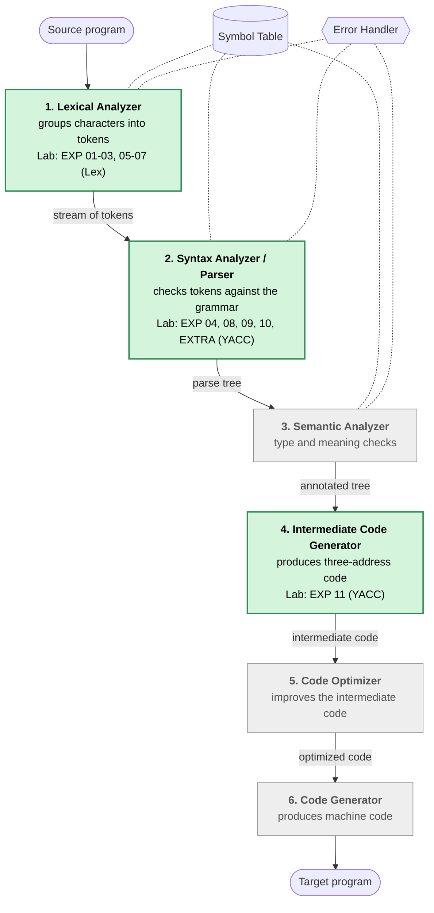
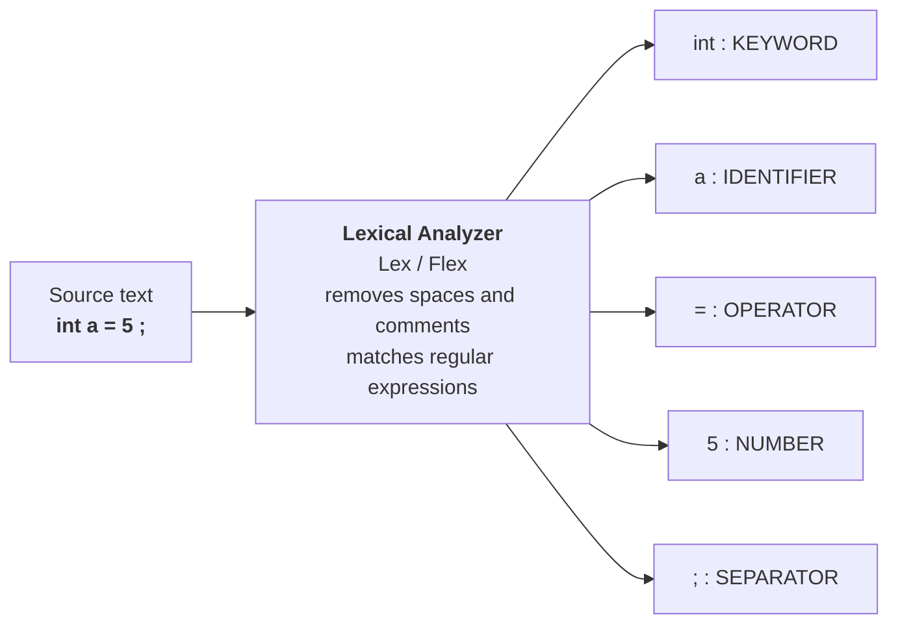
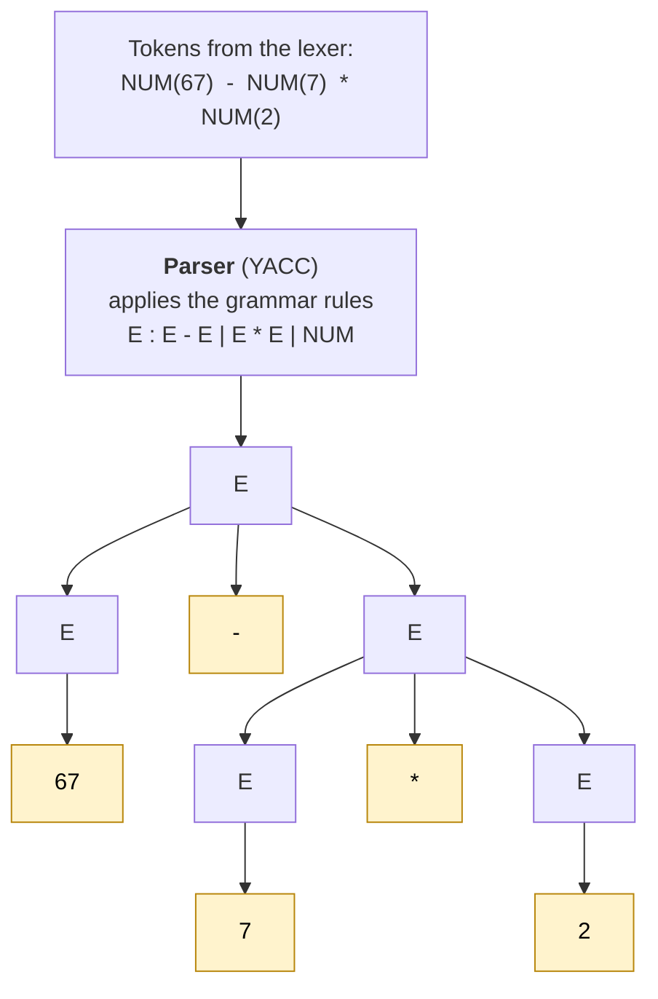
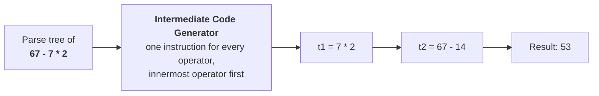

<div align="center">

# Compiler Construction Lab

**Lexical analysis • Parsing • Expression evaluation • Intermediate code generation**

<p>
  
  
  
  
</p>

</div>

---

Laboratory work for the **Compiler Construction** course, implemented with **Lex/Flex, YACC/Bison and C**. Every experiment lives in its own folder with the source code, execution screenshots and a README explaining the aim, the grammar / patterns and the expected output.

## ⚡ Quick Start

```bash
# 1. install the tools (Ubuntu / Debian / WSL)
sudo apt update && sudo apt install flex bison gcc

# 2. run any experiment by its number
chmod +x run.sh
./run.sh 9        # EXP 09 - Desk Calculator
```

Type the input, then press `Ctrl + D` to finish. `./run.sh list` shows all experiments, `./run.sh extra` runs the EXTRA one. The script builds everything in a temporary folder, so no generated files are left in the repository.

---

## 📚 Experiment Index

|   No.   | Experiment                                                     |    Tool    | Source Files                         | Run              |                                          Docs                                          |
| :-----: | -------------------------------------------------------------- | :--------: | ------------------------------------ | ---------------- | :------------------------------------------------------------------------------------: |
|  **01** | Introduction to LEX tool, metadata and patterns                |     Lex    | `practical1-1.l`, `practical1-2.l`   | `./run.sh 1`     | [📖 View](EXP%2001%29%20LEX%20tool%2C%20metadata%20and%20patterns/README.md)           |
|  **02** | Count comments, keywords, identifiers, words, lines and spaces |     Lex    | `exp2.l`                             | `./run.sh 2`     | [📖 View](EXP%2002%29%20Count%20Code%20Tokens/README.md)                               |
|  **03** | Count words starting with “A”                                  |     Lex    | `exp3.l`                             | `./run.sh 3`     | [📖 View](EXP%2003%29%20Words%20starting%20with%20%E2%80%9CA%E2%80%9D./README.md)       |
|  **04** | Introduction to YACC tool and YACC code format                 | Lex + YACC | `exp4.l`, `exp4.y`                   | `./run.sh 4`     | [📖 View](EXP%2004%29%20YACC%20tool/README.md)                                         |
|  **05** | Conversion of lowercase to uppercase and vice versa            |     Lex    | `exp5.l`                             | `./run.sh 5`     | [📖 View](EXP%2005%29%20Lowercase%20to%20Uppercase/README.md)                          |
|  **06** | Decimal ↔ hexadecimal conversion                               |     Lex    | `decimaltohexa.l`, `hexatodecimal.l` | `./run.sh 6`     | [📖 View](EXP%2006%29%20Decimal%20%E2%86%94%20Hexadecimal%20Conversion/README.md)       |
|  **07** | Test lines ending with “COM”                                   |     Lex    | `exp7.l`                             | `./run.sh 7`     | [📖 View](EXP%2007%29%20Lines%20ending%20with%20%E2%80%9CCOM%E2%80%9D/README.md)        |
|  **08** | Postfix expression evaluation                                  | Lex + YACC | `exp8.l`, `exp8.y`                   | `./run.sh 8`     | [📖 View](EXP%2008%29%20Postfix%20Expression%20Evaluation/README.md)                   |
|  **09** | Desk calculator                                                | Lex + YACC | `prac9.l`, `prac9.y`                 | `./run.sh 9`     | [📖 View](EXP%2009%29%20Desk%20Calculator/README.md)                                   |
|  **10** | `for` loop and ternary expression validation                   | Lex + YACC | `exp10.l`, `exp10.y`                 | `./run.sh 10`    | [📖 View](EXP%2010%29%20FOR%20Loop%20Expressions/README.md)                            |
|  **11** | Intermediate code generation for arithmetic expressions        | Lex + YACC | `exp11.l`, `exp11.y`                 | `./run.sh 11`    | [📖 View](EXP%2011%29%20ICG%20for%20Arithmetic%20expression/README.md)                 |
| **EXTRA** | Variable declaration statements                              | Lex + YACC | `variable.l`, `variable.y`           | `./run.sh extra` | [📖 View](EXTRA%20-%20VARIABLE%20DECLARATION%20STATEMENTS/README.md)                   |

> **Note on EXP 08:** with current Flex/Bison versions, `exp8.l` (the `++` rule) and `exp8.y` (the `expr '++'` rule) do not compile, so `./run.sh 8` stops with a build error. The postfix experiment itself works once those two lines are removed.

---

## 🧠 Phases of a Compiler

A compiler translates a source program into a target program in several phases. Each phase takes the output of the previous one. The phases highlighted in green are the ones implemented in this lab.



| Phase                          | What it does                                   | Tool used | Experiments               |
| ------------------------------ | ---------------------------------------------- | :-------: | ------------------------- |
| **Lexical Analyzer**           | Reads characters and produces tokens           |    Lex    | 01, 02, 03, 05, 06, 07    |
| **Syntax Analyzer (Parser)**   | Checks the tokens against a grammar            |    YACC   | 04, 08, 09, 10, EXTRA     |
| **Intermediate Code Generator**| Emits three-address instructions               |    YACC   | 11                        |

### 1️⃣ Lexical Analyzer

The lexical analyzer (scanner) reads the source text character by character, skips spaces and comments, and uses **regular expressions** to group the characters into **tokens**. In this lab it is written with **Lex / Flex**.



### 2️⃣ Syntax Analyzer (Parser)

The parser receives the tokens and checks whether they follow the **grammar** of the language. If they do, it builds a **parse tree**; if not, it reports a syntax error. In this lab it is written with **YACC / Bison**, and the lexer supplies the tokens.



Because `*` binds tighter than `-`, the multiplication sits deeper in the tree and is evaluated first. This is what the `%left` / `%right` precedence declarations in EXP 09 and EXP 11 control.

### 3️⃣ Intermediate Code Generator

While the parser reduces the grammar rules, the semantic action of each rule can emit **intermediate code**. EXP 11 prints one three-address style instruction for every operator, starting with the innermost one.



---

## 🧩 Concepts Covered

| Concept                                   | Experiments       |
| ----------------------------------------- | :---------------: |
| Regular expressions and Lex metadata      | 01                |
| Token counting, keywords, identifiers     | 02                |
| Comment detection                         | 02                |
| Word and line pattern matching            | 03, 07            |
| Character and number-system conversion    | 05, 06            |
| Basic YACC grammar format                 | 04                |
| Postfix expression evaluation             | 08                |
| Operator precedence and associativity     | 09, 11            |
| Postfix `++` / `--` and error handling    | 09                |
| Statement validation (`for`, `?:`)        | 10                |
| Intermediate code generation              | 11                |
| Declaration statements (recursive rule)   | EXTRA             |

---

## 📸 Preview

|                         **EXP 09 — Desk Calculator**                         |                           **EXP 11 — Intermediate Code**                           |
| :--------------------------------------------------------------------------: | :--------------------------------------------------------------------------------: |
|           |  |

---

## 📂 More Details

<details>
<summary><b>Manual build commands</b> (what <code>run.sh</code> does)</summary>

<br>

**Lex only**

```bash
cd "EXP 02) Count Code Tokens"
flex exp2.l
gcc lex.yy.c
./a.out
```

**Lex + YACC**

```bash
cd "EXP 09) Desk Calculator"
yacc -d prac9.y
flex prac9.l
gcc y.tab.c lex.yy.c
./a.out
```

Experiment 08 additionally needs `-lm` (it uses `pow()`). If the linker complains about `yywrap`, add `-ll` (or `-lfl`) to the `gcc` command.

To read input from a file instead of the keyboard: `./a.out < input.txt`

</details>

<details>
<summary><b>Repository structure</b></summary>

```text
Compiler-Construction-Lab/
│
├── README.md
├── run.sh
├── .gitignore
│
├── EXP 01) LEX tool, metadata and patterns/
│   ├── README.md
│   ├── practical1-1.l
│   ├── practical1-2.l
│   ├── prac1-1 output.png
│   └── prac1-2 output.png
│
├── EXP 02) Count Code Tokens/
│   ├── README.md
│   ├── exp2.l
│   ├── exp2 code.png
│   └── exp2 output.png
│
├── EXP 03) Words starting with “A”./
│   ├── README.md
│   ├── exp3.l
│   ├── exp3 code.png
│   └── exp3 output.png
│
├── EXP 04) YACC tool/
│   ├── README.md
│   ├── exp4.l
│   ├── exp4.y
│   ├── lex code.png
│   ├── yacc code.png
│   └── exp4 output.png
│
├── EXP 05) Lowercase to Uppercase/
│   ├── README.md
│   ├── exp5.l
│   ├── exp5 code.png
│   └── exp5 output.png
│
├── EXP 06) Decimal ↔ Hexadecimal Conversion/
│   ├── README.md
│   ├── decimaltohexa.l
│   ├── hexatodecimal.l
│   ├── decimal to hexa code.png
│   ├── decimal to hexa output.png
│   ├── hexa to decimal code.png
│   └── hexa to decimal output.png
│
├── EXP 07) Lines ending with “COM”/
│   ├── README.md
│   ├── exp7.l
│   ├── exp7 code.png
│   └── exp7 output.png
│
├── EXP 08) Postfix Expression Evaluation/
│   ├── README.md
│   ├── exp8.l
│   ├── exp8.y
│   ├── lex code.png
│   ├── yacc code.png
│   └── exp8 output.png
│
├── EXP 09) Desk Calculator/
│   ├── README.md
│   ├── prac9.l
│   ├── prac9.y
│   ├── exp9 lex.png
│   ├── exp9 yacc.png
│   └── exp9 output.png
│
├── EXP 10) FOR Loop Expressions/
│   ├── README.md
│   ├── exp10.l
│   ├── exp10.y
│   ├── exp10 lex.png
│   ├── exp10 yacc.png
│   └── exp10 output.png
│
├── EXP 11) ICG for Arithmetic expression/
│   ├── README.md
│   ├── exp11.l
│   ├── exp11.y
│   ├── exp11 lex.png
│   ├── exp 11 yacc.png
│   └── exp11 output.png
│
└── EXTRA - VARIABLE DECLARATION STATEMENTS/
    ├── README.md
    ├── variable.l
    ├── variable.y
    ├── variable lex code.png
    ├── variable yacc code.png
    └── variable output.png
```

Generated files (`lex.yy.c`, `y.tab.c`, `y.tab.h`, `a.out`) are listed in `.gitignore` and are not stored in the repository.

</details>

---

## 👩‍💻 Author

| | |
| :-- | :-- |
| **Name** | Ananya Marghade |
| **PRN** | 24070521004 |
| **Section / Batch** | A / A1 |
| **Course** | Compiler Construction Lab (2024–28) |
